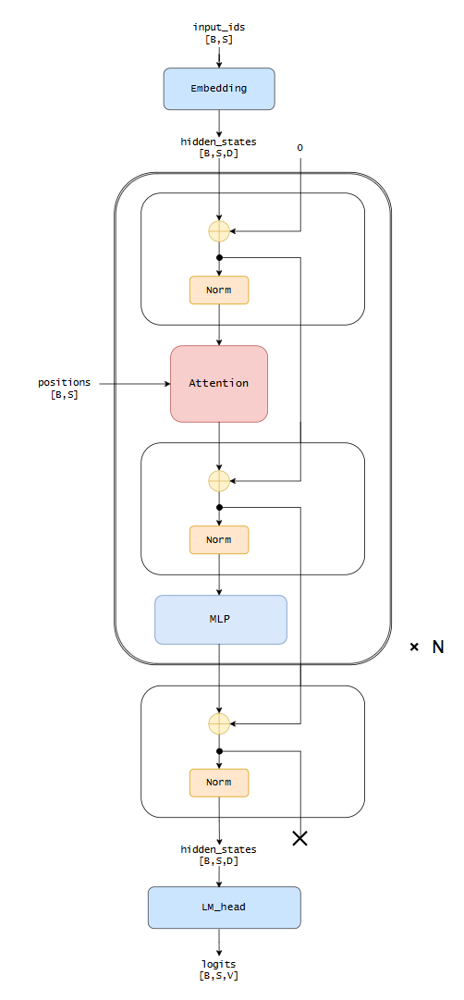
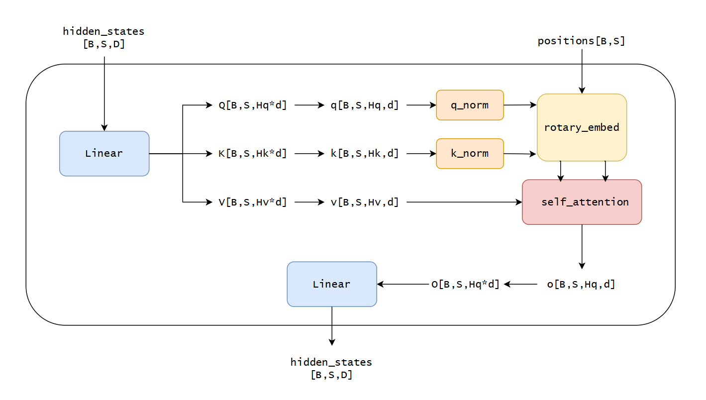
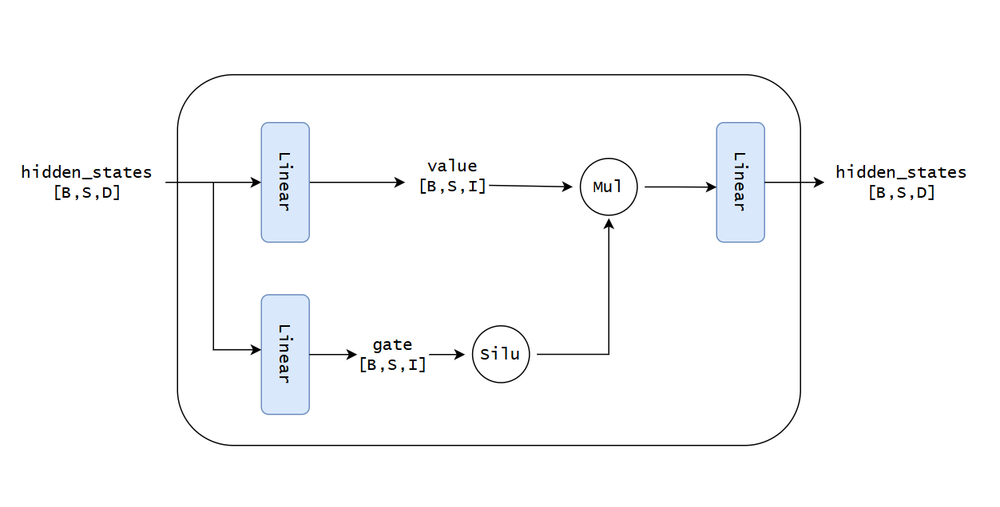

# Qwen3 模型结构

## 整体结构

输入 token 经 Embedding 后，依次通过重复的 Decoder Layer，最后经 RMSNorm 和 LM Head 得到 logits。

每层包含 Attention 和 SwiGLU MLP；两者前有 RMSNorm，并使用残差连接。

## Attention

Q、K、V 由融合线性层生成。Q、K 经 RMSNorm 和 RoPE 后参与 Attention，输出经线性层映射回隐藏维度。

## MLP

Gate 经 SiLU 后与 Value 相乘，再投影回隐藏维度。
